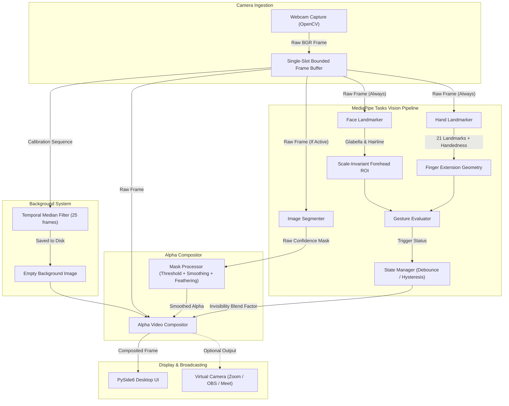

# PhantomTouch 👻✨
### Gesture-Controlled Real-Time Webcam Invisibility System

PhantomTouch is a high-performance desktop application for Windows 10/11 that makes you vanish from your webcam in real-time when you perform a specific hand gesture: **placing the index and middle fingers of your right hand against your forehead**.

When the gesture is recognized, your entire body seamlessly disappears, replaced by the original clean empty background. When you lower your hand, you instantly reappear. No physical green screens, hardware modifications, or cloud processing required.

---

## 🌟 Key Features

- **Gesture-Controlled Invisibility**: Place right index & middle fingers against your forehead to vanish; remove fingers to instantly reappear.
- **Continuous Raw Stream Tracking**: Hand and face landmarks continue to be tracked on the raw camera frames even while your body is completely absent from the composited output.
- **Robust Background Calibration**: 3-second countdown with temporal multi-frame median synthesis to produce a noise-free, flicker-free background.
- **MediaPipe Tasks Vision API**: Powered by current, official Google MediaPipe Tasks Vision models:
  - *Hand Landmarker*: 21 3D hand joints with knuckle angle & extension checks.
  - *Face Landmarker*: 468 mesh landmarks establishing dynamic, scale-invariant forehead ROI.
  - *Image Segmenter*: High-speed selfie segmentation producing continuous confidence masks.
- **Temporal Smoothing & Feathering**: Exponential moving average (EMA) mask smoothing and Gaussian edge feathering eliminate boundary jitter and harsh aliasing.
- **Debounced Hysteresis State Machine**: Prevents flickering or rapid ON/OFF toggling during momentary hand occlusion or rapid movement.
- **Modern PySide6 Dark UI**: Clean, responsive desktop interface with live aspect-ratio video preview, HUD telemetry, and interactive calibration controls.
- **Optional Virtual Camera**: Broadcast your invisible stream directly into Zoom, Google Meet, OBS, or Microsoft Teams via `pyvirtualcam`.
- **100% Offline & Private**: Zero cloud uploads, no account registration, no telemetry, and no video recording.

---

## 📐 Architecture & Pipeline



---

## 🛠️ Technology Stack

| Component | Technology | Role |
| :--- | :--- | :--- |
| **Language** | Python 3.11 / 3.12 / 3.13 | Core runtime environment |
| **Computer Vision** | OpenCV (`opencv-python`) | Video capture, color space transforms, morphology |
| **Machine Learning** | Google MediaPipe Tasks Vision | Hand Landmarker, Face Landmarker, Selfie Segmenter |
| **GUI Framework** | PySide6 (Qt for Python) | Hardware-accelerated desktop UI & multithreading |
| **Math & Arrays** | NumPy | High-performance matrix and alpha compositing operations |
| **Virtual Camera** | pyvirtualcam | Direct video loopback into communication tools |
| **Testing** | pytest | Automated test coverage for vision & state machines |

---

## 📁 Project Structure

```
PhantomTouch/
│
├── main.py                       # Main application entry point
├── requirements.txt              # Pinned Python package dependencies
├── pytest.ini                    # Pytest configuration and pythonpath
├── README.md                     # Comprehensive documentation
├── .gitignore                    # Git ignore specifications
│
├── src/
│   └── phantomtouch/
│       ├── __init__.py           # Package version definition
│       ├── app/
│       │   ├── __init__.py
│       │   ├── application.py    # QApplication lifecycle manager
│       │   └── main_window.py    # Desktop GUI layout, telemetry, and controls
│       ├── camera/
│       │   ├── __init__.py
│       │   ├── webcam_manager.py # Camera capture, enumeration, and bounded buffer
│       │   └── frame_worker.py   # Asynchronous multi-model inference worker
│       ├── vision/
│       │   ├── __init__.py
│       │   ├── hand_detector.py  # MediaPipe Hand Landmarker integration
│       │   ├── face_detector.py  # MediaPipe Face Landmarker & Forehead ROI
│       │   ├── person_segmenter.py # MediaPipe Image Segmenter
│       │   ├── gesture_detector.py # Knuckle geometry & proximity detection
│       │   └── mask_processor.py # Mask thresholding, smoothing, and feathering
│       ├── core/
│       │   ├── __init__.py
│       │   ├── state_manager.py  # Finite state machine with hysteresis debounce
│       │   ├── background_manager.py # Temporal median calibration & storage
│       │   └── compositor.py     # Alpha video compositor & smooth fader
│       ├── virtual_camera/
│       │   ├── __init__.py
│       │   └── virtual_camera_manager.py # pyvirtualcam output handler
│       ├── ui/
│       │   ├── __init__.py
│       │   ├── styles.py         # Dark mode stylesheet (QSS)
│       │   └── widgets.py        # CameraViewWidget with HUD & StatusCard
│       └── utils/
│           ├── __init__.py
│           ├── config.py         # Application settings dataclass
│           ├── logger.py         # Structured logging facility
│           └── model_manager.py  # MediaPipe model discovery & validation
│
├── models/                       # MediaPipe Tasks Vision model files (.task, .tflite)
│   ├── hand_landmarker.task
│   ├── face_landmarker.task
│   └── selfie_segmenter.tflite
│
├── data/
│   ├── backgrounds/              # Stored clean background images
│   └── settings/                 # Persisted JSON preferences
│
├── scripts/
│   ├── download_models.py        # Official Google MediaPipe model downloader
│   ├── run_windows.bat           # One-click Windows launcher
│   └── download_pyside.py        # Fallback offline wheel downloader
│
└── tests/                        # Real automated test suite
    ├── __init__.py
    ├── test_compositor.py        # Compositor and mask processor unit tests
    ├── test_background_manager.py# Background median calibration tests
    ├── test_state_manager.py     # State machine and debounce logic tests
    └── test_gesture_detector.py  # Landmark geometry and tolerance tests
```

---

## 🚀 Installation & Setup (Windows 10/11)

Follow these step-by-step PowerShell commands to install and launch PhantomTouch.

### Step 1: Clone or Navigate to the Project Directory
```powershell
cd c:\Users\user\Downloads\PhantomTouch
```

### Step 2: Create and Activate a Python Virtual Environment (Recommended)
```powershell
python -m venv venv
.\venv\Scripts\Activate.ps1
```
*(If PowerShell restricts script execution, run: `Set-ExecutionPolicy -Scope Process -ExecutionPolicy Bypass`)*

### Step 3: Install Required Dependencies
```powershell
python -m pip install --upgrade pip
pip install -r requirements.txt
```

### Step 4: Download MediaPipe Vision Models
PhantomTouch includes an automated downloader that retrieves the official Google MediaPipe task models directly from Google Cloud Storage:
```powershell
python scripts/download_models.py
```
This downloads and verifies:
- `models/hand_landmarker.task` (~7.5 MB)
- `models/face_landmarker.task` (~3.6 MB)
- `models/selfie_segmenter.tflite` (~240 KB)

---

## 🎮 How to Launch and Use PhantomTouch

### Launching the Application
You can start the desktop application either with Python or with the batch script:

**Option A: Python Command**
```powershell
python main.py
```

**Option B: One-Click Batch Script**
Double-click `scripts\run_windows.bat` in Windows File Explorer or execute in terminal:
```powershell
.\scripts\run_windows.bat
```

---

## 📖 Step-by-Step User Guide

### 1. Start the Camera
- Select your webcam from the **Camera** dropdown in the bottom control bar.
- Click **Start Camera**.
- Your live webcam stream appears in the preview window with an active status HUD.

### 2. Calibrate the Clean Background
Before invisibility can activate, the system requires a clean background without you in the scene:
1. Click **Capture Background**.
2. A 3-second countdown will display in red across the screen: `"LEAVE FRAME! Capturing in: 3.0s"`.
3. Step out of the webcam's view.
4. Over the next second, PhantomTouch will capture 25 clean frames and compute an artifact-free temporal median background image.
5. The status indicator on the right will turn green: `"Background: Ready"`.
6. Return to your seat in front of the camera.

### 3. Trigger Invisibility (The Two-Finger Gesture)
1. Raise your **RIGHT HAND**.
2. Extend your **index finger** and **middle finger** together (pointing upwards).
3. Fold your **ring finger** and **pinky finger** down against your palm (curled inward).
4. Place the tips of your index and middle fingers directly against your **forehead** (between your eyebrows and hairline).
5. Watch yourself vanish smoothly from the webcam preview! The empty background is seamlessly composited in your place.

### 4. Reappear
1. Simply lower your hand away from your forehead.
2. The invisibility effect instantly deactivates and you reappear in the live webcam feed.

---

## ⚙️ Interactive Controls & Telemetry

The right control panel allows real-time adjustments:
- **Operating Mode**: Live state readout (`NORMAL`, `GESTURE_DETECTED`, `INVISIBILITY_ACTIVATING`, `INVISIBLE`, `HOLDING`).
- **Gesture Telemetry**: Real-time diagnostic assistance:
  - *"Raise right hand"*
  - *"Extend both index and middle fingers"*
  - *"Fold ring and little fingers into palm"*
  - *"Move fingers closer to forehead (Dist: 0.28)"*
- **Manual Invisibility Override**: Checkbox to test the invisibility effect manually without having to perform the hand gesture.
- **Mirror Camera Preview**: Toggles horizontal preview flipping for a natural mirror-like webcam experience.
- **Forehead Distance Tolerance**: Adjusts sensitivity of how close fingers must be to the forehead (useful for varying camera distances).
- **Segmentation Threshold**: Fine-tunes edge confidence of the person segmentation.
- **Edge Feathering**: Controls the Gaussian blur radius to eliminate hard edges around clothes and hair.

---

## 📹 Virtual Camera Integration (Zoom, OBS, Google Meet)

PhantomTouch allows broadcasting your processed invisible stream directly into external video meeting applications:

1. Install **OBS Studio** (or an OBS Virtual Camera driver) if not already installed.
2. In PhantomTouch, check the **Virtual Camera Output (Zoom/OBS)** box.
3. Open **Zoom**, **Google Meet**, or **Teams**.
4. In the video device settings, select **OBS Virtual Camera** (or **PhantomTouch Virtual Camera**).
5. Your colleagues will see you disappear live during meetings whenever you touch your forehead!

---

## 🧪 Automated Testing

PhantomTouch includes a comprehensive test suite covering the core mathematical, state machine, and geometric pipeline without requiring camera hardware.

To run the automated test suite:
```powershell
python -m pytest tests/ -v
```

### Test Coverage Highlights:
- **`test_compositor.py`**:
  - `test_normal_mode_returns_original_frame`: Verifies inactive mode preserves exact raw video bytes.
  - `test_missing_background_returns_original`: Ensures safety against missing background data.
  - `test_full_invisibility_compositing`: Mathematical verification of `Orig*(1-Mask) + Bg*Mask`.
  - `test_feathered_alpha_blending`: Tests intermediate boundary alpha transitions.
  - `test_resolution_alignment`: Validates automatic resizing of mismatched backgrounds and masks.
  - `test_mask_thresholding`: Validates sigmoid and threshold cutoffs.
  - `test_temporal_smoothing`: Verifies exponential moving average anti-flicker stability.
- **`test_background_manager.py`**:
  - `test_save_and_load_background`: Tests PNG persistence and validation.
  - `test_multi_frame_median_combination`: Verifies temporal median noise rejection.
  - `test_clear_background`: Verifies state reset and file cleanup.
- **`test_state_manager.py`**:
  - `test_missing_background_blocks_activation`: Guarantees invisibility cannot trigger without background.
  - `test_successful_activation_sequence`: Tests state progression through debounced frames.
  - `test_hysteresis_and_debounce_hold`: Proves short detection drops (<8 frames) do not flicker.
  - `test_deactivation_after_full_hold_expires`: Tests clean restoration upon gesture release.
- **`test_gesture_detector.py`**:
  - `test_valid_two_finger_forehead_gesture`: Tests 21-landmark 3D knuckle angles and extension.
  - `test_fingers_far_from_forehead`: Validates scale-invariant forehead distance threshold.
  - `test_left_hand_rejected_when_right_required`: Enforces right hand requirement.
  - `test_ring_finger_extended_rejected`: Enforces folded finger geometry.
  - `test_check_models_validation`: Verifies model file size and integrity.

---

## 🔧 Performance & Optimization

- **Target Framerate**: 25-30 FPS on standard modern laptops with integrated webcams.
- **CPU XNNPACK Delegate**: MediaPipe inference runs on CPU with high-performance multi-threaded XNNPACK acceleration without requiring dedicated Nvidia GPUs.
- **Zero-Latency Bounded Buffer**: Webcam frames are read on a dedicated worker thread with single-slot buffers to eliminate frame lag and memory accumulation.
- **Selective Inference**: Heavy segmentation only runs when invisibility is active or transitioning, preserving CPU cycles during standard preview.

---

## ❓ Troubleshooting

| Issue | Cause | Solution |
| :--- | :--- | :--- |
| **"Could not open webcam"** | Camera occupied or index wrong | Ensure no other app (Zoom, Teams) is using the webcam. Select a different camera from the dropdown. |
| **"Background Required"** | No empty background captured | Click **Capture Background**, step out of the frame during the 3s countdown, then return. |
| **"Face not detected"** | Face out of frame or poor lighting | Ensure your face is clearly illuminated and visible in the webcam preview. |
| **"Touch Forehead" won't trigger** | Fingers slightly too far from forehead | Move fingers closer to your forehead center, or increase the **Forehead Distance Tolerance** slider. |
| **Virtual Camera box unchecks** | No virtual camera driver installed | Install [OBS Studio](https://obsproject.com/) and click "Start Virtual Camera" once in OBS to register the driver. |

---

## 🔒 Privacy Guarantee

PhantomTouch is built from the ground up with local-first privacy:
- All computer vision and machine learning inferences execute locally on your computer.
- No network requests are made during camera operation.
- No webcam video or photos are saved to the cloud.
- Only your explicitly captured background image is saved locally in `data/backgrounds/`.

---

## 📜 License

MIT License. Free for personal, academic, and commercial use.
